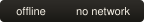
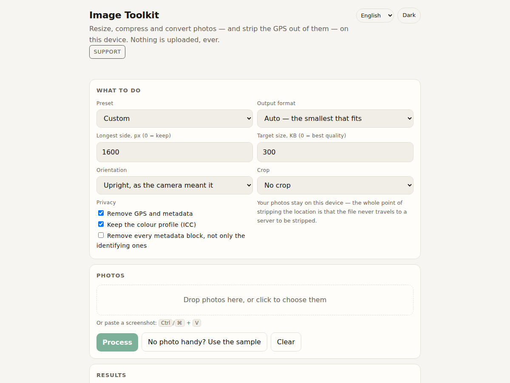
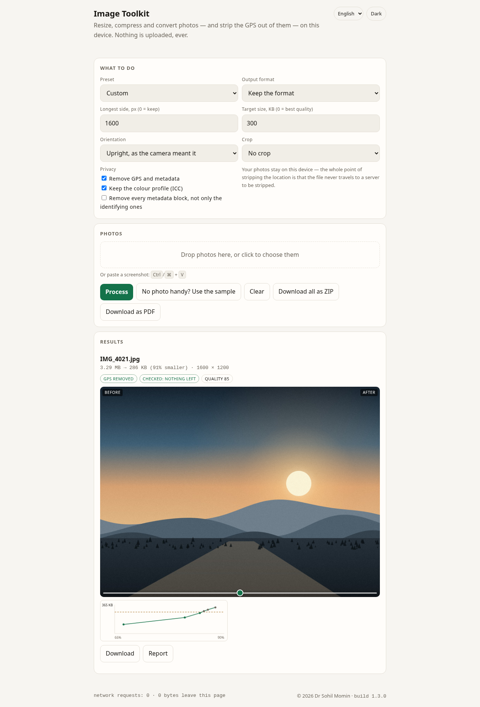

# Image Toolkit

<p>
  <a href="https://drsamonline.github.io/app-image-toolkit/"></a>
  <a href="https://github.com/drsamonline/app-image-toolkit/actions/workflows/test.yml"></a>
  <a href="https://github.com/drsamonline/app-image-toolkit/actions/workflows/build-apps.yml"></a>
  <a href="LICENSE"></a>
  
  
</p>

**Resize, compress, convert, crop and strip the GPS out of a photo — on your device, with nothing uploaded.**

**[Open the app →](https://drsamonline.github.io/app-image-toolkit/play/)** · [Landing page](https://drsamonline.github.io/app-image-toolkit/) · [The rule](#what-it-refuses-to-do)

<!-- shot:start -->



<!-- shot:end -->

Every other "compress my image" page uploads the photo first. This one cannot: there is no
server, no account and no network request. The file is read into memory, processed by the code in
this repository, and written back out. No build step, no runtime dependency — what is in
`docs/play/` is what runs. It installs as an app, it speaks English, Hindi and Gujarati, and
`python3 scripts/bundle.py` folds the whole thing into one HTML file that opens from a USB stick.



## What it does

| | |
|---|---|
| **Resize** | contain inside a box, aspect kept, never upscaled, never rounded to zero |
| **Crop and turn** | square, 4:3, 3:4, 16:9, 9:16; 90°/180°; mirror — and the EXIF orientation is read before the strip, so a portrait photo is not written out sideways |
| **Compress** | the highest quality that still fits a byte budget — a binary search, seven encoder calls at the very worst, drawn as a curve |
| **Convert** | JPEG, PNG, WebP, GIF and BMP in; JPEG, PNG or WebP out — or <em>Auto</em>, which encodes two and keeps the smaller (a source that may carry transparency is compared against WebP alone, because JPEG would flatten it) |
| **Strip** | EXIF, XMP, IPTC, JPEG comments; PNG `eXIf`/`tEXt`/`iTXt`/`zTXt` — the colour profile is kept unless you say otherwise, and “every metadata block” takes the maker notes too |
| **Check** | the *output* bytes are read back: "checked: nothing left" means the file that will be written really has nothing identifying in it |
| **Inspect** | before anything is removed, the queue shows what the file says about itself: camera, model, date, and whether there is a GPS block |
| **Batch** | paste a screenshot in, queue as many as you like, give any one of them its own settings, leave with one ZIP, one A4 PDF, or a per-file report saying exactly what was done |

The pixels are never touched by the strip: everything from the JPEG scan onwards is kept byte for
byte, and the PNG colour and image chunks are copied whole.

A first visit has no photo to work on, so the app paints one — a 3200 × 2400 landscape, grained
so it compresses like a photograph, with a real EXIF block carrying a real GPS fix (19°04′N
72°52′E). It is generated from code by `docs/play/sample.js`: there is no sample file to fetch
and nothing bundled as bytes. The sample goes through exactly the path a dropped photo takes.

## The done-means, as the spec states it

> A 4 MB photo is resized and compressed to under 500 KB without any network request.

`node test-node.js` proves it in pieces rather than asserting it whole: the budget search is
driven by a fake encoder whose output shrinks with quality (the way a real one does), so "4 MB →
under 500 KB" is a real assertion about the search; and every file that ships is scanned for an
external reference, a `fetch(`, an XHR and a remote `@import`, so "no network request" is a fact
about the code. What the test cannot prove is how a real browser's canvas encoder sizes a real
photo — that is the browser's answer, and the app reports the size it actually got. On the sample
it reports **3.29 MB → 286 KB**, 1600 × 1200, GPS gone, checked.

## What it refuses to do, and does not

- No upload, no endpoint, no `fetch`, no XHR — asserted across every shipped file, not promised in prose.
- No account, no sign-in, no analytics, no telemetry.
- No runtime dependency: `imgtool.js` is one file of plain JavaScript with no imports, and the
  `deps` badge is counted from the files that ship rather than typed.
- No build step, no bundler, no framework.
- No silent failure: a file that is not an image is refused with the type it reported; a HEIC is
  named as something a browser cannot draw, with the way out; unreadable metadata is reported as
  unreadable; a download that cannot be written says so.
- A footer counter watches for any request that leaves this origin and stays at zero.

## Run it

```bash
node test-node.js                      # the proof: 206 assertions, no dependencies
python3 -m http.server -d docs 8000    # then open http://localhost:8000/play/

python3 scripts/version.py             # one version, in every place it is written
python3 scripts/icons.py               # the icon set, from assets/icon.svg
python3 scripts/badges.py              # badges, with the counts computed
python3 scripts/bundle.py              # the whole app as one HTML file
python3 scripts/uitest.py              # the app in a headless browser: 30 checks
python3 scripts/shot.py --help         # screenshots of pages that have settled
```

There is no build step. `docs/play/` is the app. `RELEASING.md` is the six-step release.

## Layout

```
docs/index.html            the landing page — its own design, not the app's
docs/play/index.html       the app
docs/play/app.js           the view: queue and per-photo settings, results, preview, chart, ZIP
docs/play/imgtool.js       the engine — sniff, dimensions, EXIF, orientation, strip, check,
                           fit, budget, ZIP, PDF
docs/play/i18n.js          English, Hindi and Gujarati, one table
docs/play/sample.js        the sample photo, painted on a canvas when it is needed
docs/play/sw.js            the offline worker — network-first HTML, cache bumped per release
docs/play/manifest.webmanifest
docs/play/icons/           generated from assets/icon.svg
docs/play/web-kit.js       vendored, unmodified — hashed in NOTICE.md and checked
docs/play/export-kit.js    vendored, unmodified — hashed in NOTICE.md and checked
docs/assets/               screenshots and generated badges
assets/icon.svg            the one master mark
scripts/                   version, icons, badges, bundle, shot
test-node.js               the proof
```

Both surfaces are light by default, follow the system preference on first paint, and carry a
toggle that is remembered — under separate keys, so setting one never changes the other.

## Licence

PolyForm Noncommercial 1.0.0 — free for personal, hobby and educational use; commercial use
needs a paid licence. The engine is under the same licence as everything else, as its header
says; the two vendored kits in `docs/play/` are MIT, and `NOTICE.md` records which is which.
© 2026 Dr Sohil Momin.
